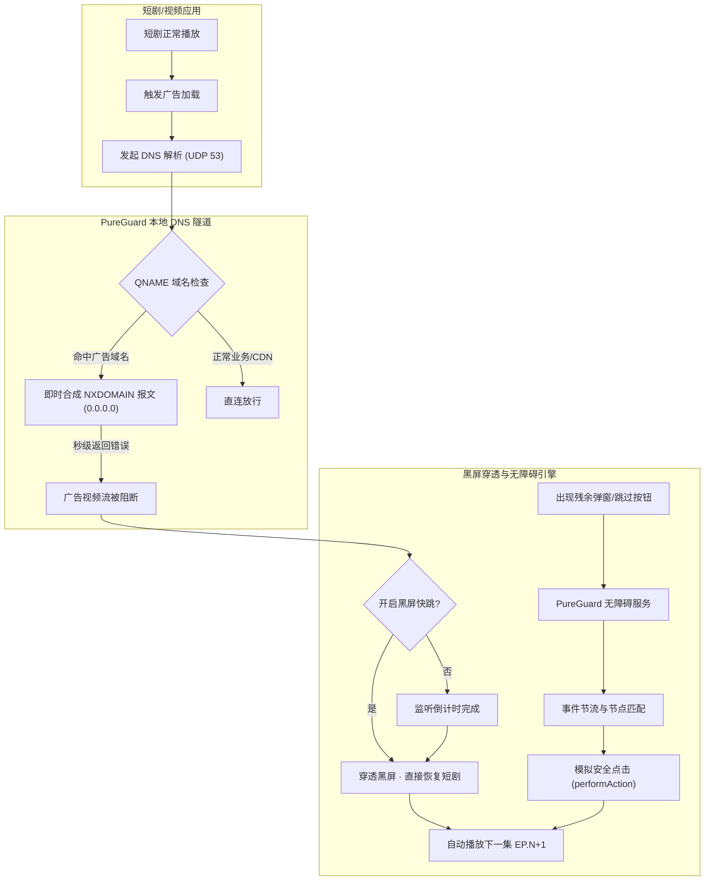

<div align="center">

# 🛡️ PureGuard (净剧卫士)

**Android 极速无感短剧广告净化与黑屏穿透秒跳引擎**

[](https://github.com/codywon/pureguard/releases)
[](https://github.com/codywon/pureguard/actions)
[](https://developer.android.com)
[](LICENSE)

</div>

---

## 📖 项目简介 (Overview)

**PureGuard (净剧卫士)** 是一款专为提升短剧观看体验而打造的高性能 Android 本地广告拦截与自动跳过工具。

在观看短剧和视频应用时，常见的广告拦截往往导致播放器“**黑屏死等倒计时**”，甚至卡死无法继续播放。PureGuard 通过**本地轻量虚拟 DNS 隧道 + 系统级无障碍辅助引擎 + 黑屏穿透快跳保护**的三维协同机制，彻底解决广告加载与黑屏停滞问题，实现短剧流畅自动连播。

---

## ✨ 核心特性 (Key Features)

- ⚡ **本地零延迟 DNS 隧道 (Local DNS Tunnel)**
  - 基于 Android `VpnService` 构建纯本地回环 DNS 虚拟接口，仅路由 DNS 报文（端口 53）。
  - **绝不代理任何视频与数据流量**，正常短剧 CDN 直连传输，零带宽损耗、零画质压缩。

- 🚫 **即时 NXDOMAIN 阻断与响应合成**
  - 高效解析 IPv4 UDP DNS 请求，精准识别穿山甲 (Pangolin)、优量汇 (GDT) 等广告 SDK 域名。
  - 原地纳秒级合成 DNS `NXDOMAIN` (0x8183) 错误报文即时返回，阻断播放器加载广告流，杜绝请求挂起。

- ⏩ **黑屏穿透秒跳保护 (Black-Screen Bypass)**
  - 针对视频广告流被过滤后播放器出现的黑屏、倒计时卡顿、无法自动下一集等问题，提供专项保护。
  - 倒计时归零时自动释放黑屏蒙层并触发播放状态机，无缝切入下一集短剧。

- 🎯 **系统级无障碍自动化点击 (Accessibility Engine)**
  - 免 Root 自动识别全屏广告、开屏倒计时、插屏弹窗与“跳过/关闭”按钮。
  - 引入毫秒级防抖动与 `TYPE_WINDOW_CONTENT_CHANGED` 智能节流机制，功耗极低，绝不引起界面掉帧。

- 📋 **GKD 规则订阅格式导出**
  - 支持将应用内置规则一键导出为标准 [GKD (李跳跳/自定义规则)](https://github.com/gkd-kit/gkd) 订阅 JSON 格式，方便规则备份与多设备共享。

- 📊 **可视化沙箱与实时拦截日志**
  - 内置短剧模拟沙箱，直观测试激励视频、开屏、插屏广告的拦截与跳转效果。
  - 实时记录拦截域名、命中规则、执行耗时与节省时间。

---

## 🏗️ 架构与工作原理 (Architecture)



---

## 🛠️ 技术栈 (Tech Stack)

| 模块 | 核心技术 / 库 | 说明 |
| :--- | :--- | :--- |
| **编程语言** | Kotlin 2.0+ | 强类型、现代协程支持 |
| **界面框架** | Jetpack Compose + Material 3 | 声明式响应式 UI，流畅动效 |
| **异步流** | Coroutines & StateFlow | 高效状态流转，轻量事件驱动 |
| **网络层** | Android `VpnService` | 虚拟 TUN 网卡与 UDP 报文底层快速解析 |
| **系统交互** | Android `AccessibilityService` | 节点树低功耗扫描与精准无感点击 |
| **持续集成** | GitHub Actions | 云端自动化构建、签名与多架构 APK 发布 |

---

## 🚀 快速开始 (Getting Started)

### 1. 下载与安装
前往 [Releases 页面](https://github.com/codywon/pureguard/releases) 下载最新版本的 APK 文件并在手机上安装。

### 2. 授权与启动
1. 打开 **PureGuard**；
2. **启用 DNS 过滤**：点击首页顶部的“启动过滤隧道”，系统将提示建立本地 VPN 虚拟连接，点击“允许”；
3. **开启系统辅助跳过**（可选但推荐）：根据提示打开“无障碍服务”中的 PureGuard 开关，即可享有全自动跳过弹窗与关闭按钮功能；
4. **黑屏快跳保护**：在“高级控制”面板中确保“黑屏快跳保护”已开启，在短剧 App 中畅享零广告、零黑屏连续播放。

---

## 💻 源码编译 (Build From Source)

### 环境要求
- JDK 17
- Android SDK 34 / 36
- Android Studio Ladybug 或更高版本

### 命令行编译
```bash
# 克隆仓库
git clone https://github.com/codywon/pureguard.git
cd pureguard

# 编译 Release APK
./gradlew assembleRelease

# 编译产物位于 app/build/outputs/apk/release/app-release-unsigned.apk
```

---

## 🔒 隐私与安全性 (Privacy & Security)

- **100% 本地运算**：PureGuard 的 DNS 解析、报文过滤和规则匹配均在本地设备运行。
- **不收集隐私**：应用不包含任何第三方跟踪 SDK，不建立任何外部代理服务器，不会记录或上传用户的浏览记录和网络包。
- **完全开源透明**：代码全开源，接受社区监督与贡献。

---

## 📄 开源许可证 (License)

本项目采用 [Apache License 2.0](LICENSE) 许可证开源。
